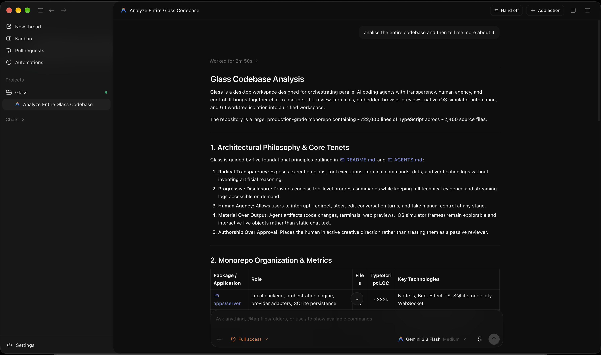

# Glass

**A fundamental architecture of interaction.**

Glass makes automation visible, understandable, and controllable without making it overwhelming. Every meaningful agent action should be inspectable. Every important decision should be understandable. Every evolving artifact should remain accessible to its creator.

Glass keeps people actively involved in shaping work. People remain the authors making consequential decisions, with the ability to interrupt, redirect, inspect, revise, and take manual control wherever the underlying runtime permits.

## The Glass philosophy

Glass is built around five architectural principles:

1. **Radical transparency:** Expose available plans, tool execution, commands, changes, failures, and verification evidence. Never invent reasoning that a provider does not expose.
2. **Progressive disclosure:** Make complexity accessible without forcing everyone to confront it. Help people move from a clear progress summary to detailed technical evidence when they need it.
3. **Human agency:** Let people interrupt, redirect, inspect, revise, and take manual control wherever the underlying runtime permits.
4. **Material over output:** Keep an agent's result explorable, manipulable, and improvable—not only as a completed response in a chat.
5. **Authorship over approval:** Keep the human actively shaping the work and making consequential decisions, rather than acting as a passive reviewer of autonomous output.

## Interaction architecture

Glass begins with human intent: objectives, constraints, judgment, and creative direction. Its interaction layer provides visibility, intervention, context, artifact manipulation, and evidence across external coding agents such as Codex, Claude Code, OpenCode, and other supported runtimes. Interface decisions follow from what a person can understand and control at each stage of the work.

The defining test is an unwanted change: can a person understand what changed, trace it to an observable action, inspect the affected artifact, correct the direction, and continue without unnecessarily losing useful progress? That complete experience guides Glass more than any individual dashboard, animation, or icon.

<p align="center">
  
</p>

## What Glass does

- Organizes projects into Spaces and tracks active work in Activity.
- Connects coding-agent providers, including Codex, Claude, Cursor, Grok, and Pi.
- Runs parallel agents in isolated Git worktrees and supports provider handoffs.
- Brings chat, terminals, diffs, browser previews, and pull-request workflows into one workspace.
- Stores conversations, credentials, and application state locally by default.
- Exposes MCP tools and resources for agent workflows.

## Requirements

- [Bun](https://bun.sh), version 1.3.12 (see `.mise.toml`).
- Node.js 24.13.1 (see `.mise.toml`).
- Git. Provider CLIs and credentials are needed only for the providers you use.

## Set up a development checkout

```sh
mise install
bun install --frozen-lockfile
bun run build
```

Start the web workspace and server:

```sh
bun run dev
```

Start the desktop app with live reload:

```sh
bun run dev:desktop
```

The setup helper can install dependencies and build the workspace with `./scripts/setup.sh`.

## Build and verify

```sh
bun run build
bun run fmt:check
bun run lint
bun run typecheck
bun run test
```

Release artifacts and platform startup checks are documented in the release workflow under `.github/workflows/`.

## How the code is organized

- `apps/web` — React and TanStack Router user interface.
- `apps/server` — local HTTP/WebSocket server, provider sessions, orchestration, persistence, Git, terminals, workspace tools, and MCP.
- `apps/desktop` — Electron main process, preload bridge, native browser, and update lifecycle.
- `packages/contracts` — shared schemas and protocol types.
- `packages/shared` — runtime utilities shared across applications.
- `scripts` — development, verification, packaging, and release tooling.

The server stores orchestration events in SQLite and projects them into queryable state. Provider runtimes are managed by server adapters; their events flow back into orchestration and then to connected clients.

## Project

- Repository: [Suryanshu-Nabheet/Glass](https://github.com/Suryanshu-Nabheet/Glass)
- License: MIT. See [LICENSE](./LICENSE).
